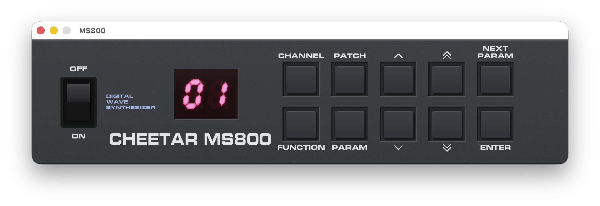

# MS800 emulator



An emulator for the **Cheetah MS800** digital wave synthesizer from 1987:
a 6502 running the original firmware, the SGS-Thomson M114S wavetable chip,
a 6850 ACIA for MIDI, and the front panel. Slop coded as a fun adventure with Claude and real hardware (pcb photos, sound A/B'ing etc) as a reference.

- Runs the real v1.0 firmware ROM; MIDI in/out via CoreMIDI (appears as **MS800**
  and **MS800 Out**).
- M114S playback of the 8-bit PCM wave ROM, including the MS800's PCB waveform
  address mapper, dual-table crossfades and stereo outputs.
- Timer rate, attenuation curve and output filtering are fitted to recordings of
  a real unit.
- Clickable front panel; keys `1`–`9`/`0` press the panel buttons, Space toggles power.

Requires copies of the original program and wavetable ROMs to run (not included here!).

## Building (macOS)

```sh
brew install cmake sdl2
# put the ROM dumps in roms/ (see roms/README.md)
cmake -S . -B build
cmake --build build
./build/ms800-emu
```

The panel artwork is compiled into the binary. To regenerate it (if needed):

```sh
python3 -m pip install pillow
python3 tools/gen_panel_art.py   # rewrites assets/*.bmp and standalone/panel_layout.h
cmake --build build
```

Run with `--trace` to log every M114S channel programme (with the mapped wave-ROM
addresses) to stderr.

## Plugin (CLAP, VST3, AU)

```sh
cmake -S . -B build -DMS800_BUILD_PLUGIN=ON
cmake --build build --target ms800_all
# -> build/plugins/MS800.clap, MS800.vst3, MS800.component
```

Configuring downloads [clap-wrapper](https://github.com/free-audio/clap-wrapper)
and the CLAP, VST3 and AudioUnit SDKs. Add `-DMS800_PLUGIN_INSTALL=ON` to copy the
plugins into `~/Library/Audio/Plug-Ins` after each build.

The plugin is an instrument with a stereo output, a MIDI input and a MIDI
output (whatever the firmware transmits, such as SysEx bank dumps). Its editor
is the front panel: click the buttons, watch the display, use the power switch.
The battery-backed RAM (user patches and setup) is saved with the host project.
Host program 1 selects patch 1 (the firmware's own numbering is offset by one).

ROMs are not built in. The plugin looks for `ms800-10-prog.bin` and
`ms800-waveform-rom.bin` in, in order: `$MS800_ROM_DIR`,
`~/Library/Application Support/MS800/roms/`, and the plugin bundle's
`Contents/Resources/roms/`. A local build bundles any ROMs found in `roms/`
(or `-DMS800_PLUGIN_ROM_DIR=...`) into the plugins, so don't distribute those
builds.

## Layout

| Path | What |
|---|---|
| `core/` | `ms800_core`, a self-contained C11 library emulating the whole machine (6502 + firmware glue, M114S, 6850 ACIA, wave address latch, panel I/O). No platform dependencies; public API in `core/include/ms800.h`. |
| `standalone/` | The SDL2 app: front panel, audio, CoreMIDI ports. |
| `plugin/` | The CLAP plugin (`ms800_clap.c`), wrapped to VST3 and AUv2 by clap-wrapper. |
| `tools/` | Panel artwork generator. |

The core supports any number of machines at once, on any threads, at any
sample rate: create one with `ms800_create()`, feed it MIDI with
`ms800_midi_in()`, and pull audio with `ms800_render_s16()` or
`ms800_render_f32()`. `ms800_get_ram()` / `ms800_set_ram()` save and restore
the battery-backed RAM (user patches and setup).

## Licence

MIT (see `LICENSE`). Bundled third-party code keeps its own licence — see
`THIRD_PARTY.md` (BSD-3-Clause for the M114S and 6850 ports, CC0 for the 6502 core,
OFL for the Saira font).
